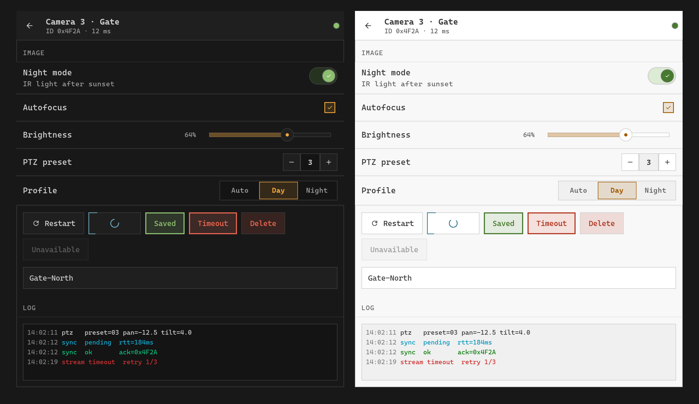

<p align="center">
  
</p>

<h1 align="center">Operator Design System</h1>

<p align="center">
  A compact, technical design system for applications that monitor and control devices.
  <br>
  Terminal look, sharp corners, warm signal colors, and honest feedback for every async action.
</p>

<p align="center">
  <a href="https://github.com/pavver/operator-design-system/actions/workflows/ci.yml"></a>
  <a href="https://github.com/pavver/operator-design-system/releases"></a>
  
  <a href="#license"></a>
</p>

<p align="center">
  <a href="https://pavver.github.io/operator-design-system/"><b>Documentation</b></a>
  ·
  <a href="#components">Components</a>
  ·
  <a href="https://github.com/pavver/operator-design-system/releases">Releases</a>
</p>

<p align="center">
  
</p>

## Overview

Operator UI looks like a terminal or a control panel: Cascadia Code everywhere, gray editor-like surfaces, and `0 DU` corners.
Every control shows the life of an asynchronous request: pending, success, and error are part of the component, not an afterthought.

The repository contains three things:

* **The system:** principles, units, color, type, motion, and the shared state model, in [docs](docs).
* **Tokens:** one TOML file that generates CSS, Rust, and Kotlin sources.
* **Implementations:** hand-written components per platform, currently the web (Leptos).

The [documentation site](https://pavver.github.io/operator-design-system/) renders the same Markdown files that AI agents read, next to live examples of every component.

## Quick Start (Leptos)

Add the crate, pinned to a release:

```toml
[dependencies]
leptos = { version = "0.8", features = ["csr"] }
operator-ui = { git = "https://github.com/pavver/operator-design-system", tag = "v0.6.0" }
```

Wrap the application in `ThemeRoot`.
It sets the theme attributes and injects the token and component stylesheets once.

```rust
use leptos::prelude::*;
use operator_ui::prelude::*;

#[component]
fn App() -> impl IntoView {
    let name = RwSignal::new("Gate-North".to_string());
    view! {
        <ThemeRoot>
            <TextField
                value=name
                placeholder="Device name"
                on_save=AsyncAction::new(|value: String| async move {
                    // send `value` to the backend here
                    let _ = value;
                    ActionResult::Success
                })
            />
        </ThemeRoot>
    }
}

fn main() {
    leptos::mount::mount_to_body(App);
}
```

Build it with [Trunk](https://trunkrs.dev) for the `wasm32-unknown-unknown` target.
The application provides Cascadia Code through `@font-face`; [demo.css](web/operator-ui-demo/demo.css) shows how.
More in [Web (Leptos)](docs/platforms/web.md).

## Cargo Features

The `operator-ui` crate provides one feature per component.
Unused components ship neither code nor CSS in the final build.

| Feature | Contents |
| :--- | :--- |
| `reviewed` | Every reviewed component (default). |
| `draft` | Components still in progress. |
| `full` | `reviewed` and `draft`. |
| `<component>` | One component and the components it uses, for example `action-button` or `toast`. |
| `arborium` | Tree-sitter highlighting for `CodeBlock` (opt-in, see below). |

Select individual components:

```toml
operator-ui = { git = "https://github.com/pavver/operator-design-system", tag = "v0.6.0", default-features = false, features = ["action-button", "toast"] }
```

The `arborium` feature uses the arborium crate for `CodeBlock` highlighting.
It is excluded from group features because compiling its C tree-sitter grammars to WebAssembly requires LLVM and clang with wasm support.
Applications enable `arborium` and the individual `arborium/lang-*` grammars they need in their own manifest.

## Components

✅ reviewed in every state · 🚧 draft.
New components start as draft and become reviewed after they have been checked in every state.

**Actions**

| Component | Specification | Web |
| :--- | :--- | :---: |
| ActionButton | [action-button.md](docs/components/action-button.md) | ✅ |
| IconButton | [icon-button.md](docs/components/icon-button.md) | ✅ |
| Menu, MenuButton, ContextMenu | [menu.md](docs/components/menu.md) | ✅ |
| Toolbar | [toolbar.md](docs/components/toolbar.md) | 🚧 |

**Selection**

| Component | Specification | Web |
| :--- | :--- | :---: |
| AsyncSwitch | [switch.md](docs/components/switch.md) | ✅ |
| AsyncCheckbox | [checkbox.md](docs/components/checkbox.md) | ✅ |
| CheckboxGroup | [checkbox-group.md](docs/components/checkbox-group.md) | ✅ |
| RadioGroup | [radio-group.md](docs/components/radio-group.md) | ✅ |
| SegmentedControl | [segmented-control.md](docs/components/segmented-control.md) | ✅ |
| Slider | [slider.md](docs/components/slider.md) | ✅ |
| Stepper | [stepper.md](docs/components/stepper.md) | ✅ |
| Chip | [chip.md](docs/components/chip.md) | ✅ |
| ThemeToggle | [theme-toggle.md](docs/components/theme-toggle.md) | ✅ |

**Text input**

| Component | Specification | Web |
| :--- | :--- | :---: |
| TextField | [text-field.md](docs/components/text-field.md) | ✅ |
| TextArea | [text-area.md](docs/components/text-area.md) | ✅ |
| SearchField | [search-field.md](docs/components/search-field.md) | ✅ |
| DropdownMenu | [dropdown-menu.md](docs/components/dropdown-menu.md) | ✅ |
| Combobox | [combobox.md](docs/components/combobox.md) | ✅ |

**Feedback**

| Component | Specification | Web |
| :--- | :--- | :---: |
| Tooltip | [tooltip.md](docs/components/tooltip.md) | ✅ |
| Toast | [toast.md](docs/components/toast.md) | ✅ |
| Banner | [banner.md](docs/components/banner.md) | ✅ |
| LinearProgress | [linear-progress.md](docs/components/linear-progress.md) | ✅ |
| Skeleton | [skeleton.md](docs/components/skeleton.md) | ✅ |
| EmptyState | [empty-state.md](docs/components/empty-state.md) | ✅ |
| StatusBadge | [status-badge.md](docs/components/status-badge.md) | ✅ |

**Overlays**

| Component | Specification | Web |
| :--- | :--- | :---: |
| Dialog | [dialog.md](docs/components/dialog.md) | ✅ |
| ConfirmDialog (Dialog preset) | [confirm-dialog.md](docs/components/confirm-dialog.md) | ✅ |
| Sheet | [sheet.md](docs/components/sheet.md) | 🚧 |

**Navigation**

| Component | Specification | Web |
| :--- | :--- | :---: |
| Header | [header.md](docs/components/header.md) | ✅ |
| Tabs | [tabs.md](docs/components/tabs.md) | ✅ |
| Pagination | [pagination.md](docs/components/pagination.md) | ✅ |

**Data display**

| Component | Specification | Web |
| :--- | :--- | :---: |
| ListItem | [list-item.md](docs/components/list-item.md) | ✅ |
| DataTable | [data-table.md](docs/components/data-table.md) | 🚧 |
| PropertyList | [property-list.md](docs/components/property-list.md) | 🚧 |
| Accordion, Collapsible | [accordion.md](docs/components/accordion.md) | ✅ |
| Counter | [counter.md](docs/components/counter.md) | ✅ |
| Avatar | [avatar.md](docs/components/avatar.md) | ✅ |
| CodeBlock | [code-block.md](docs/components/code-block.md) | ✅ |
| Kbd | [kbd.md](docs/components/kbd.md) | ✅ |
| ConsoleTerminal | [console-terminal.md](docs/components/console-terminal.md) | ✅ |
| MarqueeText | [marquee-text.md](docs/components/marquee-text.md) | ✅ |
| Icon, ProgressIndicator, Divider, Card | [primitives.md](docs/components/primitives.md) | ✅ |

**Layout**

| Component | Specification | Web |
| :--- | :--- | :---: |
| SplitPane | [split-pane.md](docs/components/split-pane.md) | ✅ |
| ScrollArea | [scroll-area.md](docs/components/scroll-area.md) | ✅ |
| Scrollbar, ScrollView | [scrollbar.md](docs/components/scrollbar.md) | ✅ |

## Documentation

| Foundations | Engineering |
| :--- | :--- |
| [Principles](docs/foundations/principles.md) | [Web (Leptos)](docs/platforms/web.md) |
| [Units: DU and TU](docs/foundations/units.md) | [Tokens and code generation](docs/tokens.md) |
| [Color](docs/foundations/color.md) | [Porting to a new platform](docs/porting.md) |
| [Typography](docs/foundations/typography.md) | [Releasing](docs/releasing.md) |
| [Iconography](docs/foundations/iconography.md) | |
| [Motion](docs/foundations/motion.md) | |
| [States and async feedback](docs/foundations/states.md) | |

## Development

```bash
cargo run -p operator-tokens            # regenerate tokens after editing tokens/tokens.toml
cd web/operator-ui-demo && trunk serve  # documentation site at http://127.0.0.1:8090/
```

Before committing, run `scripts/check-features.sh` to build every component feature on its own.

```
tokens/                           tokens.toml and SVG icons (source of truth)
tools/operator-tokens/            token generator
tools/import_material_symbols.py  icon importer
crates/operator-ui-tokens/        generated Rust tokens (no_std)
generated/kotlin/                 generated Compose tokens
web/operator-ui/                  Leptos component library
web/operator-ui-demo/             documentation site with live examples (renders docs/)
docs/                             the design system itself
assets/brand/                     logo: still mark (also the favicon) and animated version
assets/screenshots/               README screenshot (from the demo page #/showcase)
scripts/                          release and feature-check helpers
```

## License

Code and documentation are dual-licensed under [MIT](LICENSE-MIT) or [Apache-2.0](LICENSE-APACHE), at your option.
The bundled font and icon paths have their own licenses, see [NOTICE.md](NOTICE.md).
